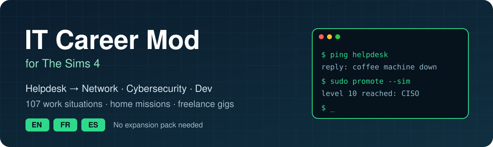

<p align="center"></p>

# Mod Carrera de Informática para Los Sims 4

[English](README.md) · [Français](README.fr.md) · **Español**

[](https://github.com/mxthis971/sims4-it-career-mod/releases/latest)
[](https://github.com/mxthis971/sims4-it-career-mod/releases)


[](LICENSE)

> Tu Sim arregla la impresora, bloquea a un hacker, sobrevive a la caída del servidor de las 3 de la mañana… y tú aprendes informática de verdad.

Una nueva **carrera de Informática** para Los Sims 4, creada por un estudiante de informática. Empieza en el soporte técnico y elige tu camino en el nivel 5: **Administrador de redes**, **Ciberseguridad** o **Desarrollo de software**. Por el camino, situaciones laborales realistas te enseñan conceptos reales (VLAN, copias de seguridad, phishing, RGPD…), explicados de forma sencilla.

Disponible en **español, inglés y francés** (el juego elige tu idioma automáticamente).

<p align="center"><a href="https://github.com/mxthis971/sims4-it-career-mod/releases/latest"></a></p>

## Por qué te va a gustar

- **Decisiones reales en el trabajo**: 107 situaciones en las que decides qué hace tu Sim, con consecuencias en el rendimiento, el dinero y las habilidades.
- **Aprende de verdad**: cada resultado termina con un «¿Lo sabías?» escrito por un estudiante de informática (phishing, VLAN, copias de seguridad, RGPD…).
- **Juega desde casa**: misiones y trabajos freelance en cualquier ordenador, incluso para adolescentes y Sims sin empleo.
- **Ligero**: 2 archivos, sin packs de expansión ni otros mods.

### Ejemplo de situación

> **El código QR trampa**
> Han aparecido en el vestíbulo de la empresa pegatinas con un código QR de «Wi-Fi gratis».
>
> **Opción:** *Quitarlas y avisar a todos*
> El código QR llevaba a una página de inicio de sesión falsa que robaba contraseñas. Nadie ha caído.
>
> 💡 *¿Lo sabías? Un código QR es solo un enlace oculto: se comprueba la dirección antes de escribir nada (quishing).*

## Contenido

- **1 carrera, 3 ramas, 10 niveles cada una**: Becario de soporte → Técnico (niveles 1 a 4), y luego hasta CIO, CISO o CTO.
- **107 situaciones en el trabajo** con decisiones durante la jornada: 40 de Administración de redes, 40 de Ciberseguridad, 8 de Desarrollo, 8 para los primeros niveles y 11 para todos (reclutadores, aumentos, entrevista anual, RGPD, becarios…). Cada resultado termina con un «¿Lo sabías?».
- **Horarios variados y realistas**: turnos de noche en el SOC, semanas de 4 días, guardias el sábado… no solo de 9 a 17.
- **Misiones en el ordenador de casa** (Ordenador › Carrera › «Misión: …»): completan la tarea diaria «Misiones a distancia» y suben el rendimiento.
- **Trabajos freelance** para cualquier Sim adolescente o mayor, aunque no tenga empleo (Ordenador › Carrera › «Freelance: …»): desde reparar un PC (120 §) hasta bug bounty (2000 §, Programación 8, puede fallar).
- **Compatible con «Días de universidad»** (opcional): el título de Informática da un impulso en esta carrera.

## Requisitos

- Los Sims 4, probado en la versión **1.121.361**. No hace falta ningún pack.
- En el juego: *Opciones › Opciones de juego › Otros*: marca **Habilitar contenido personalizado y mods** y **Mods de scripts permitidos**, y reinicia el juego.

## Instalación

1. Descarga la última versión en la página de [Releases](../../releases).
2. Pon los 2 archivos en `Documentos\Electronic Arts\Los Sims 4\Mods` (o en una sola subcarpeta, no más):
   - `mathis_CarriereInformatique.package`
   - `mathis_CarriereInformatique.ts4script`
3. Inicia el juego. El empleo está en el móvil o el ordenador: *Buscar empleo › Informática*.

## Trucos útiles

```
testingcheats true
careers.promote mathis_InfoIT_career
```

## Limitaciones conocidas

- Las misiones y los trabajos freelance los añade el script a los ordenadores. Si no aparecen, comprueba que los mods de scripts están activados y envía el archivo `lastException*.txt` (en `Documentos\Electronic Arts\Los Sims 4`) en una [issue](../../issues).
- La carrera reutiliza iconos del juego.

## Compilar desde el código fuente

La carpeta `src/` contiene los scripts de compilación (`python3 build.py`) y todos los textos (`src/cards*.py`, `src/home.py`, traducciones en `src/i18n/`). Las plantillas XML y los SimData extraídos del juego **no** están incluidos (pertenecen a EA): hay que extraerlos de tu propia copia del juego a `src/tpl/` y `src/ref/`.

## Licencia

[CC BY-NC 4.0](LICENSE): puedes compartirlo y modificarlo citando al autor, **sin uso comercial**.
Los Sims 4 es una marca de Electronic Arts Inc. Este mod no está afiliado ni respaldado por EA.

---

Si te gusta el mod, una ⭐ en esta página ayuda a otros jugadores a encontrarlo.
