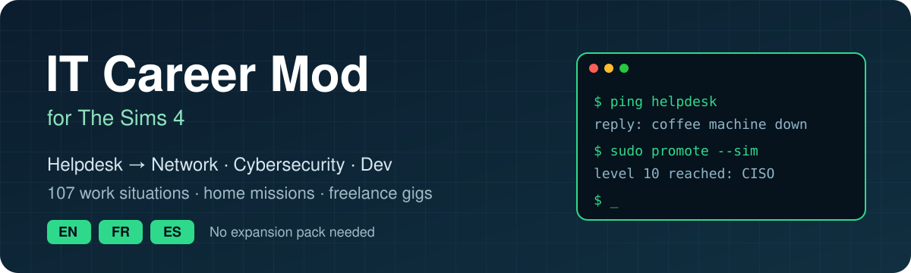

<p align="center"></p>

# Mod Carrière Informatique pour Les Sims 4

[English](README.md) · **Français** · [Español](README.es.md)

[](https://github.com/mxthis971/sims4-it-career-mod/releases/latest)
[](https://github.com/mxthis971/sims4-it-career-mod/releases)


[](LICENSE)

> Ton Sim répare l'imprimante, bloque un pirate, survit à la panne de serveur de 3 h du matin… et toi, tu apprends la vraie informatique au passage.

Une nouvelle **carrière Informatique** pour Les Sims 4, créée par un étudiant en informatique. Commence au helpdesk, puis choisis ta voie au niveau 5 : **Administrateur réseau**, **Cybersécurité** ou **Développement logiciel**. En chemin, des situations de travail réalistes t'apprennent de vraies notions (VLAN, sauvegardes, phishing, RGPD…), expliquées simplement.

Disponible en **français, anglais et espagnol** (le jeu choisit ta langue tout seul).

<p align="center"><a href="https://github.com/mxthis971/sims4-it-career-mod/releases/latest"></a></p>

## Pourquoi tu vas aimer

- **De vrais choix au travail** : 107 situations où tu décides ce que fait ton Sim, avec des conséquences sur la performance, l'argent et les compétences.
- **Apprendre pour de vrai** : chaque résultat se termine par un « Le savais-tu ? » écrit par un étudiant en informatique (phishing, VLAN, sauvegardes, RGPD…).
- **Jouer depuis la maison** : missions et contrats freelance sur n'importe quel ordinateur, même pour les ados et les Sims sans emploi.
- **Léger** : 2 fichiers, aucun pack d'extension, aucun autre mod requis.

### Exemple de situation

> **Le QR code piégé**
> Des autocollants avec un QR code « Wi-Fi gratuit » sont apparus dans le hall de l'entreprise.
>
> **Choix :** *Les retirer et prévenir tout le monde*
> Le QR code menait vers une fausse page de connexion qui volait les mots de passe. Personne ne s'est fait avoir.
>
> 💡 *Le savais-tu ? Un QR code est juste un lien caché : on vérifie l'adresse avant de saisir quoi que ce soit (quishing).*

## Contenu

- **1 carrière, 3 branches, 10 niveaux chacune** : Stagiaire Helpdesk → Technicien (niveaux 1 à 4), puis jusqu'à DSI, RSSI ou CTO.
- **107 situations au travail** avec des choix pendant la journée : 40 Admin réseau, 40 Cybersécurité, 8 Dev, 8 pour les premiers niveaux et 11 pour tout le monde (recruteurs, augmentation, entretien annuel, RGPD, stagiaire…). Chaque résultat finit par un « Le savais-tu ? ».
- **Horaires variés et réalistes** : nuits au SOC, semaines de 4 jours, astreinte le samedi… pas seulement 9h-17h.
- **Missions sur l'ordi de la maison** (Ordinateur › Carrière › « Mission : … ») : elles remplissent la tâche quotidienne « Missions à distance » et font monter la performance.
- **Contrats freelance** pour tout Sim ado ou plus, même sans emploi (Ordinateur › Carrière › « Freelance : … ») : du dépannage de PC (120 §) au bug bounty (2000 §, Programmation 8, peut échouer).
- **Compatible « À la fac »** (facultatif) : le diplôme d'Informatique donne un coup de pouce dans cette carrière.

## Prérequis

- Les Sims 4, testé en version **1.121.361**. Aucun pack nécessaire.
- Dans le jeu : *Options › Options de jeu › Autres* : coche **Activer le contenu personnalisé et les mods** et **Mods de script autorisés**, puis redémarre le jeu.

## Installation

1. Télécharge la dernière version sur la page [Releases](../../releases).
2. Mets les 2 fichiers dans `Documents\Electronic Arts\Les Sims 4\Mods` (ou dans un seul sous-dossier, pas plus) :
   - `mathis_CarriereInformatique.package`
   - `mathis_CarriereInformatique.ts4script`
3. Lance le jeu. Le métier se trouve dans le téléphone ou l'ordinateur : *Trouver un emploi › Informatique*.

## Codes de triche utiles

```
testingcheats true
careers.promote mathis_InfoIT_career
```

## Limites connues

- Les missions et le freelance sont ajoutés aux ordinateurs par le script. S'ils n'apparaissent pas, vérifie que les mods de script sont activés et envoie le fichier `lastException*.txt` (dans `Documents\Electronic Arts\Les Sims 4`) dans une [issue](../../issues).
- La carrière réutilise des icônes du jeu.

## Construire depuis les sources

Le dossier `src/` contient les scripts de construction (`python3 build.py`) et tous les textes (`src/cards*.py`, `src/home.py`, traductions dans `src/i18n/`). Les modèles XML et les SimData extraits du jeu ne sont **pas** inclus (ils appartiennent à EA) : il faut les extraire de ton propre jeu dans `src/tpl/` et `src/ref/`.

## Licence

[CC BY-NC 4.0](LICENSE) : libre de partager et modifier en citant l'auteur, **pas d'usage commercial**.
Les Sims 4 est une marque d'Electronic Arts Inc. Ce mod n'est ni affilié ni approuvé par EA.

---

Si le mod te plaît, une ⭐ sur cette page aide les autres joueurs à le trouver.
