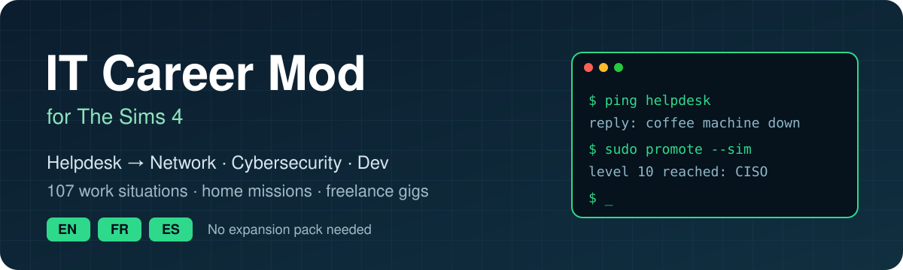

<p align="center"></p>

# Sims 4 IT Career Mod

**English** · [Français](README.fr.md) · [Español](README.es.md)

[](https://github.com/mxthis971/sims4-it-career-mod/releases/latest)
[](https://github.com/mxthis971/sims4-it-career-mod/releases)


[](LICENSE)

> Your Sim fixes the printer, blocks a hacker, survives the 3 a.m. server crash… and you learn real IT along the way.

A new **IT career** for The Sims 4, made by an IT student. Start at the helpdesk, then choose your path at level 5: **Network Administrator**, **Cybersecurity** or **Software Development**. Along the way, real-life work situations teach you actual IT concepts (VLANs, backups, phishing, GDPR…), explained simply.

Available in **English, French and Spanish** (the game picks your language automatically).

<p align="center"><a href="https://github.com/mxthis971/sims4-it-career-mod/releases/latest"></a></p>

## Why you will like it

- **Real choices at work**: 107 situations where you decide what your Sim does, with consequences on performance, money and skills.
- **Learn something for real**: every outcome ends with a short "Did you know?" written by an IT student (phishing, VLANs, backups, GDPR…).
- **Play from home**: missions and freelance gigs on any computer, even for teens and unemployed Sims.
- **Lightweight**: 2 files, no expansion pack, no other mod needed.

### Example situation

> **The Booby-Trapped QR Code**
> Stickers with a "Free Wi-Fi" QR code have appeared in the company lobby.
>
> **Choice:** *Remove them and warn everyone*
> The QR code led to a fake login page that stole passwords. Nobody fell for it.
>
> 💡 *Did you know? A QR code is just a hidden link: check the address before typing anything (quishing).*

## Features

- **1 career, 3 branches, 10 levels each**: Helpdesk Intern → Technician (levels 1–4), then up to CIO, CISO or CTO.
- **107 work situations** with choices while your Sim is at work: 40 Network Admin, 40 Cybersecurity, 8 Dev, 8 for the first levels and 11 for everyone (recruiters, raises, annual review, GDPR, interns…). Each outcome ends with a short "Did you know?" tip.
- **Varied, realistic schedules**: night shifts in the SOC, 4-day weeks, on-call Saturdays… not just 9 to 5.
- **Missions on the home computer** (Computer › Career › "Mission: …"): they fill the new daily task "Remote Missions" in the career panel and raise work performance.
- **Freelance gigs** for any Sim aged teen or older, even without a job (Computer › Career › "Freelance: …"): from fixing a PC (§120) to bug bounties (§2000, Programming 8, may fail).
- **Discover University compatible** (optional): the Computer Science degree boosts this career.

## Requirements

- The Sims 4, tested on version **1.121.361**. No expansion pack required.
- In the game: *Options › Game Options › Other*: tick **Enable Custom Content and Mods** and **Script Mods Allowed**, then restart the game.

## Installation

1. Download the latest version from the [Releases](../../releases) page.
2. Put both files in `Documents\Electronic Arts\The Sims 4\Mods` (or one subfolder, no deeper):
   - `mathis_CarriereInformatique.package`
   - `mathis_CarriereInformatique.ts4script`
3. Start the game. Find the job via the phone or computer: *Find a Job › IT*.

## Useful cheats

```
testingcheats true
careers.promote mathis_InfoIT_career
```

## Known limitations

- The missions and freelance gigs are added to computers by the script. If they don't show up, check that script mods are enabled and send the `lastException*.txt` file (in `Documents\Electronic Arts\The Sims 4`) in an [issue](../../issues).
- The career reuses existing game icons.

## Building from source

The `src/` folder contains the build scripts (`python3 build.py`) and all texts (`src/cards*.py`, `src/home.py`, translations in `src/i18n/`). The XML templates and SimData extracted from the game are **not** included (they belong to EA): you need to extract them from your own copy of the game into `src/tpl/` and `src/ref/`.

## License

[CC BY-NC 4.0](LICENSE): free to share and adapt with credit, **no commercial use**.
The Sims 4 is a trademark of Electronic Arts Inc. This mod is not affiliated with or endorsed by EA.

---

If you enjoy the mod, a ⭐ on this page helps other players find it.
